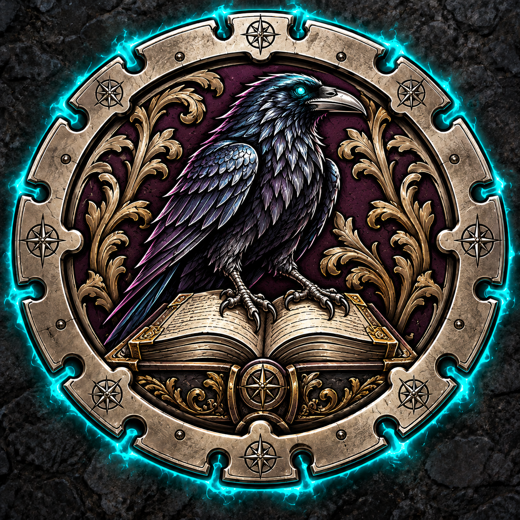
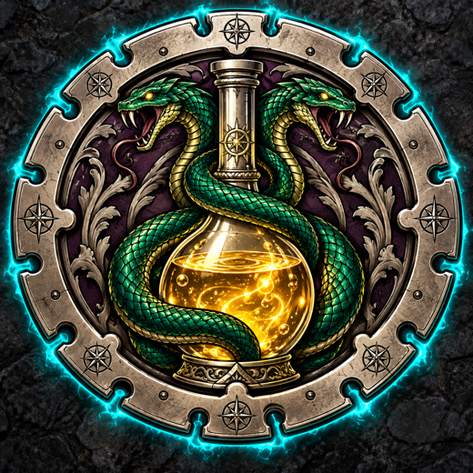
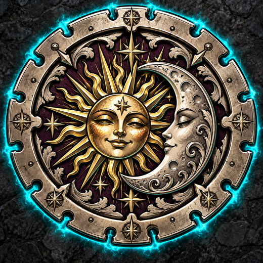
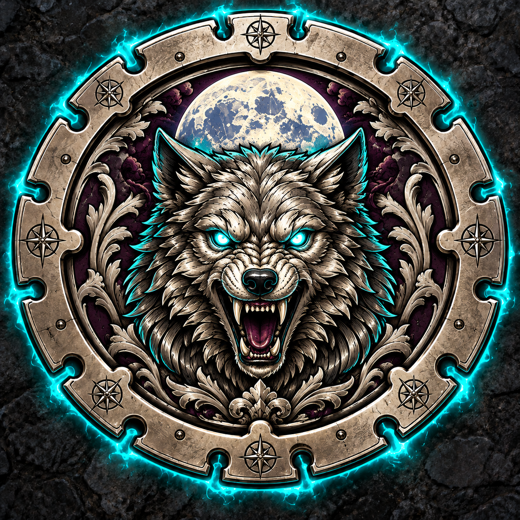
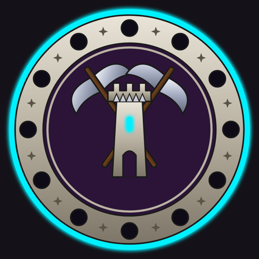

<!-- cover -->
    

# The Von Zarovich Estate

## The Dungeon Master's Grimoire

A Halloween escape-room one-shot for Dungeons & Dragons 5e · Ten Level 5 heroes · Five cursed rooms · One Grand Gate

*Complete lore, rules, hints and solutions for Stations 1–5, the opening and the unmasking. For the Lead GM and helper GMs only. Keep it behind the screen.*
<!-- /cover -->

<!-- page -->

# Contents

| Part | Chapter | What you'll find |
|---|---|---|
| I | The Lore of the Estate | The Count, the Five Crests, the staff, and the truth behind the Phantom |
| II | The Heroes and Their Rooms | Which character is bound to which room, and why |
| III | Running the Evening | Run of show, the helper system, the clue envelopes |
| IV | Station 1 · The Library | The Crown and the Dagger: Fred & Griffin |
| V | Station 2 · The Alchemist's Laboratory | The Trickster's Coin: Quasimodo & Shaggy |
| VI | Station 3 · The Clockwork Observatory | Of Gears and Gadgets: Drac & Johnny |
| VII | Station 4 · The Mimic Menagerie | Wands and Keys: Scooby-Doo & Murray |
| VIII | Station 5 · The Collapsing Armory | Corridor of the Taboo Word: Frank & Wayne |
| IX | The Grand Gate & the Unmasking | Transition, minion fight, accusation, capture, confession |
| X | Quick Reference | Every DC, every answer, every reward on one page |

<!-- box.note: How to Read This Grimoire -->
- **Read-aloud text** sits in pink-edged boxes. Read it as written or in your own words.
- **Hints** are numbered 1–4 and match the sealed envelopes your helper GMs hold. Hint 4 is always the emergency bailout.
- **Solutions** sit in dark boxes marked *DM EYES ONLY*. Never let a player see those pages.
- **Character bindings** name each hero's signature power and exactly how it works in that room. Every pair has a room built for them.
- The station files in `Stations/` hold the long-form detail. This grimoire is the complete working guide, current as of the latest rules revision.
<!-- /box -->

<!-- page -->

# Part I · The Lore of the Estate

<!-- box.lore: The House of Von Zarovich -->
High above the valley, wrapped in fog that never quite lifts, stands the Von Zarovich Estate. For three centuries it belonged to a bloodline of scholars, farmers, admirals, smiths and kings, each stranger than the last. The six greatest of them still stand in the Library as stone statues, hands held out as if expecting a gift: **Victoria** the Arch-Librarian, **Alexi** the Harvester, **Teresa** the Traitor, **Admiral Valerius**, **Borislav** the Forge-Master and **King Barov the Spotless**, who ruled from above and never dirtied his hands.

The last of the line was **Count Von Zarovich**. He trusted no one. Before he died, he locked his fortune behind the **Grand Gate**, a black iron door in the great hall with five empty sockets in a ring and a lock shaped like a snarling wolf. He broke the Gate's key into **five Crests** and hid one in each of the Estate's five strangest rooms, each guarded by a curse of his own design:

- the **Library**, where the ancestors must be given their due;
- the **Alchemist's Laboratory**, where a Trickster god accepts only a fraud;
- the **Clockwork Observatory**, where the stars themselves set the gears;
- the **Mimic Menagerie**, where three of four keys are lies;
- the **Collapsing Armory**, where one word must never be spoken.
<!-- /box -->

<!-- box.lore: The Masquerade of the Five Crests -->
Every Halloween since the Count's death, the Estate opens its doors for the **Masquerade of the Five Crests**. The legend is simple: whoever brings back all five Crests claims the Count's fortune. For a hundred years nobody has managed it.

This year the strangest guest list in history has climbed the hill: a vampire, a werewolf dad, a mummy, a very large and very nervous Frankenstein, an invisible man, a backpacker, a chef with a rat, and a van full of meddling kids and their dog.
<!-- /box -->

<!-- box.lore: The Estate Staff (all three are suspects) -->
| Staff | Who they seem to be | What they're like |
|---|---|---|
| **Anton, the Alchemist's Apprentice** | Brisk young man with the guest list; "professional disagreement" with his master | Defensive, quick, eager to take your bags |
| **Master Tobias, the Clockmaker** | Small, snowy-haired, obsessed with schedules | Fussy; "touch nothing that ticks" |
| **Grisela, the Groundskeeper** | Towering, muddy spade, unimpressed by everything | Dry; "if a skeleton asks for directions, send him to me" |

The opening introduces all three equally. **Never spotlight Anton.**
<!-- /box -->

<!-- box.secret: DM EYES ONLY · The Truth Behind the Phantom -->
There is no ghost. The "**Ghost of Count Von Zarovich**" is **Anton, the Alchemist's Apprentice**, in a costume.

Anton is the "fool" in the Alchemist's ledger, the apprentice who weighed bottles two by two and wasted the whole night. His master fired him. Bitter and clever, Anton spent a year **re-arming every one of the Count's old curses**: the shrieking gargoyle, the Clockwork Phantom, the mimics, the collapsing ceiling. Then he played the ghost to scare off every Masquerade guest, so that one day the treasure would be his alone.

He left clues everywhere. He is **left-handed**, he **works with potions**, he is **short** with small boots, his hair is **stained purple** from his experiments, and he **reeks of sulfur**. Each station's reward includes one Evidence Card that points to one of these traits. In the finale the heroes combine all five to unmask him.

**Opening foreshadowing:** the "ghost" floats about kid height, points with its **left** hand, and leaves a smell of **rotten eggs**. Say each hint once, casually.
<!-- /box -->

<!-- page -->

# Part II · The Heroes and Their Rooms

<!-- box.lore: The Binding -->
When the Phantom flings open the doors of the great hall, the floor tilts like a ship and the Estate's old magic **sorts the guests in pairs**, each pair pulled through the door whose curse their talents were made to break. Every room is designed around two character sheets. A pair that reads its sheets will always find a way through.
<!-- /box -->

| Station | Room | Bound Heroes | Class | Signature power in this room |
|---|---|---|---|---|
| 1 | The Library | **Fred Jones** | Fighter (Tactician) | *Let's Split Up!*: both partners inspect two statues at once, with Advantage |
| | | **Griffin, the Invisible Man** | Rogue (Invisible Scout) | *Now You Don't*: the gargoyle can't see him. *Mage Hand Shenanigans* reaches Barov's tall plinth |
| 2 | The Alchemist's Laboratory | **Quasimodo** | Artificer (Deranged Chef) | *Esmeralda the Rat*: sniffs out and clears one genuine vial |
| | | **Shaggy Rogers** | Rogue (Survivalist) | *Iron Stomach*: tastes vials safely and powers the bailout belch |
| 3 | The Clockwork Observatory | **Count Dracula (Drac)** | Bard (Vampire Lord) | *Bat Form* flies to the painted dome. *Look Into My Eyes!* freezes the Phantom |
| | | **Johnny** | Bard (Chill Backpacker) | *DJ Backpack* stuns the Phantom. *Sick Beats* cancels one bad crank |
| 4 | The Mimic Menagerie | **Scooby-Doo** | Barbarian (Loyal Beast) | *Scooby Snack Surge*: a real snack, +14 Perception to sniff out the mimic or the illusion |
| | | **Murray Mummy** | Druid (Desert Caster) | *Sandstorm Shuffle* restrains the mimic. *Bandage Whip* taps pedestals from 2 squares |
| 5 | The Collapsing Armory | **Frankenstein (Frank)** | Barbarian (Tank) | *Massive Shoulders*: holds the falling ceiling, automatic success |
| | | **Wayne Werewolf** | Barbarian (Exhausted Dad) | *Wolf Senses* hears the right pipe. *Swarm of Pups* fetches the crest through the grate |

<!-- box.note: Uses and Rests -->
Every hero has **3 uses** shared across their three abilities. Treat the walk into a station as a short rest: refresh all three uses at the start of the station, and again before the finale.

**Fewer than 10 players?** Run fewer stations, or give a lone player both characters' sheets. Every station still needs its Crest for the Gate, so a GM can hand over the reward of any unrun station during the transition.
<!-- /box -->

<!-- page -->

# Part III · Running the Evening

| Clock | Phase | Lead GM | Helper GMs |
|---|---|---|---|
| 0:00–0:15 | Arrival | Snacks, costumes, invitations, seat the pairs | Stations covered, envelopes packed |
| 0:15–0:20 | **The Opening** | Invitation, meet the staff, the Phantom, "Let's split up!", rules | Stand by |
| 0:20–0:37 | **The Stations** (10–15 min) | Float and hype; master 15-minute timer | Run the station clock and open envelopes on cue |
| ~0:32–0:37 | **Transition** | Crest moment at the Gate; flip the Suspect Board | Envelope 5 on solve; send the pair to the Gate |
| 0:37 | **The Bell** | Ring it: hard stop | Open Envelope 4 for any pair still working; finish within about 1 min |
| 0:38–0:52 | **The Finale** | Gate → minions → accusation → capture → unmasking | Run minion clusters |
| 0:52–1:00 | Case Closed | Certificates, brag round, group photo | Collect props |

<!-- box.note: The Envelope System (identical at every station) -->
| Envelope | Name | When | What's inside |
|---|---|---|---|
| 1 | **Look Around** | 2–3 min | Sensory or environmental clue |
| 2 | **Your Sheet** | 5–6 min | Hint tied to a character's ability |
| 3 | **The Rule** | 8–9 min | The logic constraint that unlocks the solution |
| 4 | **SEALED: Emergency** | 11:00, or after a critical mistake | The bailout. Helper's call only |
| 5 | **Reward** | On solve | The station's **Crest** + one **Evidence Card** |

**Golden rules for every helper:**
- Ask questions; never give answers.
- Say identical results in identical words.
- Reward clever ideas that aren't in the book.
- Nobody drops to 0 HP.
- The bell at 15:00 ends every station.
<!-- /box -->

<!-- page -->

<!-- station: 1 · crest_1 -->
# Part IV · Station 1 · The Library

*Empty hands. Watchful eyes.* · Adapted from **The Crown and the Dagger** (*The Game Master's Book of Traps, Puzzles and Dungeons*, Ch. 11)
<!-- /station -->

<!-- box.lore: Lore of the Room -->
The Library holds the memory of the bloodline. Six ancestors stand in stone, each marked forever by the life they led: ink, mud, blood, brine, soot, and one whose hands were never dirtied at all. The Count's curse is simple: **give each ancestor the tool that marked them**, and the Archive Gate opens. Insult them, and the gargoyle above the hearth wakes up. Hand the crown to the traitor or the dagger to the king, and an angry spirit rises.
<!-- /box -->

<!-- box.bound: Bound Heroes: Fred Jones & Griffin -->
- **Fred, "Let's Split Up!"** (station ruling): once here, Fred and his partner inspect two different statues at once, **both with Advantage**. Fred's **Survival** (+3) reads the mud; his **Net Trap** (DC 13 Dex) pins the Spectre.
- **Griffin, "Now You Don't":** the gargoyle only shrieks at what it can *see*. Griffin is never targeted, so point it out the first time; it's his big moment.
- **Griffin, "Mage Hand Shenanigans":** inspects Barov's tall plinth without climbing, and floats the crown into Barov's raised hands. Without it, climbing is Athletics DC 12. His **Sleight of Hand** (+7) can pick dried blood from under Teresa's nails.
<!-- /box -->

<!-- box.read: Read Aloud -->
> Dust hangs in the candlelight. Six stone ancestors stand in alcoves, grey with a century of grime, their empty hands held out as if waiting for a gift. On the reading table, under a rumpled velvet runner, lie six stone relics. Above the fireplace, a stone gargoyle's eyes seem to follow whoever touches the table. One statue, its plaque reading only "Barov", stands higher than the rest on a tall plinth.
<!-- /box -->

<!-- box.rules: Setup & Rules -->
- **Setup:** six statue cards, first-name side up (1 Victoria · 2 Alexi · 3 Teresa · 4 Valerius · 5 Borislav · 6 Barov, raised on a box). Six relic tokens under a cloth runner. The gargoyle above the "fireplace". Spectre standee hidden. Telling Detail slips 1–6 held by the helper.
- **Inspecting a statue:** Investigation **DC 13** (Fred +4, Griffin +5). Success: hand over that statue's **Telling Detail slip**. Fail: *"Only dust and stone. Try a different approach."* Retry next turn with a new approach. The clue is never locked behind one roll.
- **Barov needs no roll.** Any close look finds *nothing at all, not even dust*: hand over slip 6.
- **Handling is safe.** Picking up, moving or inspecting relics triggers nothing. Only a **placement**, offering a relic to a statue, counts.
- **Wrong placement:** the statue shudders and **every** placed relic clatters back to the table.
- **Second wrong placement onward:** the gargoyle shrieks at everyone it can see, DC 12 Wis save or 1d6 psychic. Griffin is never targeted.
- **The Taboo Swap** (dagger to Barov or crown to Teresa): a minor **Spectre** rises (AC 12, 14 HP, +4 to hit, 1d6 necrotic), ending in about a minute. This is the critical mistake that unlocks Hint 4.
- **Neutral warning:** before *any* crown or dagger placement, say *"The gargoyle's eyes flare red. Are you sure?"* Say it every time, right or wrong.
<!-- /box -->

<!-- box.hint: The Four Hints -->
**Hint 1 · Look Around** (2–3 min; lift the runner, no roll, or Investigation DC 11 on the table; at 3:00 it slides off by itself). Hand over the **Reading Table Inscription**:
> "Six walked before the master. The scholar reads while the tiller reaps; the smith burns while the sailor weeps. The killer's hands are scarlet stained, while one sits clean above the pain."

**Hint 2 · Your Sheet** (5–6 min): *"Fred, your sheet says you love splitting up."* / *"Griffin, Barov's hands are way up there. Anything that reaches far?"*

**Hint 3 · The Rule** (8–9 min; inspect a plinth, DC 12, or automatically at 9:00). Hand over the **Plinth Plate**:
> I. The hand is marked by what it held. II. The hand that never worked shall hold what was never earned.

**Hint 4 · SEALED** (11:00, or after the Taboo Swap). A ghost librarian mutters, at first only the pairs not yet placed; the full line at 13:00:
> "Give the book to the ink, the scythe to the mud, the hammer to the soot, the spear to the brine, the crown to the spotless one, and the dagger to the blood!"
<!-- /box -->

<!-- box.note: Nudges (questions, never answers) -->
- *"That velvet runner is lumpy. Anyone curious?"*
- *"These are statues of real people. What would a statue remember about the person?"*
- *"You've found five stains. What's strange about the sixth statue?"*
- Arguing over "tiller": *"What does a tiller do in a field?"*
<!-- /box -->

<!-- box.secret: DM EYES ONLY · Solution -->
| Statue | Telling detail | Relic |
|---|---|---|
| 1 · Arch-Librarian Victoria | Ink ground into her fingertips | **Book** |
| 2 · Lord Alexi the Harvester | Dried mud on boots and coat hem | **Scythe** |
| 3 · Lady Teresa the Traitor | Crimson stains on palms and under nails | **Dagger** |
| 4 · Admiral Valerius | Salt, brine and barnacles | **Spear** |
| 5 · Forge-Master Borislav | Soot on jaw, knuckles and forearms | **Hammer** |
| 6 · King Barov the Spotless | Nothing. Not even dust. | **Crown** |

**Reward (Envelope 5):** flip the cards to show the full titles. **Archive Crest #1** + **Evidence Card E1, "The Borrowed Book"**: a library book whose signature is smeared right-to-left by a **left-handed** writer.
<!-- /box -->

<!-- page -->

<!-- station: 2 · crest_2 -->
# Part V · Station 2 · The Alchemist's Laboratory

*Ten bottles. One liar.* · Adapted from **The Trickster's Coin** (Ch. 12)
<!-- /station -->

<!-- box.lore: Lore of the Room -->
The Count's alchemist worshipped the **Smiling Shadow**, god of forgers and frauds, whose altars accept only the false thing and never the true one. Before the alchemist left, he hid the Crest behind the jester-faced altar and set it a riddle of weight: **ten identical vials, nine genuine quicksilver, one a hollow fake**. Only a balance scale can tell them apart. The alchemist's scorched ledger still sits in the desk. It complains about a foolish apprentice who weighed the bottles two by two and wasted the whole night. **That apprentice was Anton.**
<!-- /box -->

<!-- box.bound: Bound Heroes: Quasimodo & Shaggy Rogers -->
- **Quasimodo, "Esmeralda the Rat"** (Action): Esmeralda finds the one vial with a hairline crack in its seal and smells real quicksilver. That vial is **genuine** and cleared (#1, or the lowest-numbered suspect under the Shuffle). Use only while 3 or more suspects remain. She can never find the fake.
- **Shaggy, "Iron Stomach":** no harm from tasting a vial, only the comic side effect. He may spend a use to end his own side effect, and he powers the **Hint 4 belch**.
- **Rolls:** neither sheet lists Religion or Investigation. Roll raw INT: Quasimodo d20+4, Shaggy d20+0.
<!-- /box -->

<!-- box.read: Read Aloud -->
> The door creaks onto a cramped laboratory that smells of sulfur and burnt sugar. Ten amber bottles stand in a brass rack, each sealed with black wax and stamped with a number, one to ten. On the workbench sits a brass balance scale with two pans hanging from a grinning bat. Against the far wall, in front of a sealed iron door, a stone jester holds an empty brass bowl in its clawed hands and grins at you.
<!-- /box -->

<!-- box.rules: Setup & Rules -->
- **Setup:** ten identical vial cards (1–10) in the rack, the scale mat with the tilt card on LEVEL, the jester altar, the Weighing Log, and the side-effect cards.
- **Running the scale:** players load the pans and say "weigh." Answer with exactly one phrase: **"The LEFT pan rises." · "The RIGHT pan rises." · "The pans hang perfectly level."**
  - **Uneven counts:** the pan with more vials drops. This tells them nothing about the fake.
  - **Even counts:** the pan holding the fake rises. If the fake is on neither pan, the pans hang level.
- **Mode (choose before play):** **Fixed**, where vial #6 is the fake (the book default, simplest), or the **Trickster's Shuffle**, where the fake always hides in the largest group of current suspects. The Shuffle defeats lucky guessing but needs a suspect tracker behind the screen.
- **Weighing cap:** 4 free weighings. On the 4th the scale creaks. From the 5th, the bat shrieks and the weigher rolls a side effect. The puzzle never becomes unwinnable.
- **Wrong offering:** sizzle and colourful smoke; the jester spits the vial back (now cleared). The offerer rolls d6: **1** Bubble Burps · **2** Helium Voice · **3** Radioactive Glow · **4** Sneezing Fit · **5** Heavy Boots · **6** Tingling Fingers. There is **no damage** anywhere in this room.
- **Quick rulings:**
  - **"I drink it!":** the seals are enchanted, so only a drop gets through and they roll a side effect.
  - **Hefting by hand:** *"They feel exactly the same."*
  - **Clever alternative comparisons:** count as one free weighing.
<!-- /box -->

<!-- box.hint: The Four Hints -->
**Hint 1 · Look Around** (2–3 min; inspect the altar). The **Altar Inscription**:
> "The Trickster mocks honest gold and heavy metal. Give to my bowl the hollow lie, the weightless fraud, the lightest craft, and the gate shall grant you passage."

On Religion DC 10, read aloud: *"This is an altar of the Smiling Shadow, god of forgers and frauds. It accepts only the false thing."*

**Hint 2 · Your Sheet** (4–6 min; Quasimodo sends Esmeralda): she sneezes at Vial #1's cracked seal. *"That one is the real thing."*

**Hint 3 · The Rule** (8–9 min; search the desk, Investigation DC 10; they still find it after a minute on a fail). The **Scorch-Marked Ledger**:
> "Night forty. My apprentice weighs the bottles two by two and wastes the whole night. Fool. A scale answers three ways, not two: left rises, right rises, or it hangs even. When it hangs even, it speaks of the bottles left on the table. Weigh many at once. Keep some aside. And never trust a scale with uneven pans."

**Hint 4 · SEALED** (11:00, or after a wrong offering with a frustrated table): Shaggy wolfs down a sandwich and lets out an echoing BURRRP. Glowing pink bubbles settle on **three** vials, one of them the fake. The players still do the last weighing.
<!-- /box -->

<!-- box.note: Nudges -->
- Weighing 1 vs 1: *"Does the scale only take one bottle per pan?"*
- After LEVEL, "that told us nothing!": *"Did it tell you nothing, or something about the bottles left on the table?"*
- Going in circles: *"Which vials can you be sure are real right now?"*
<!-- /box -->

<!-- box.secret: DM EYES ONLY · Solution -->
**The method:** group weighing. 10 suspects always take 3 weighings. 9 suspects (after Esmeralda) take 2, but only with a 3-3-3 split.
- **Fixed mode, 10 vials:** W1 {1–5} vs {6–10}: RIGHT rises. W2 {6,7} vs {8,9}, 10 aside: LEFT rises. W3 6 vs 7: LEFT rises. **Vial #6.**
- **Fixed mode, 9 vials** (#1 cleared): W1 {2,3,4} vs {5,6,7}, {8,9,10} aside: RIGHT rises. W2 5 vs 6, 7 aside: RIGHT rises. **Vial #6.**
- The fake goes in the jester's bowl and the iron door swings open.

**Reward (Envelope 5):** **Alchemist Crest #2** + **Evidence Card E2, "The Singed Sleeve"**: a lab-coat sleeve with quicksilver burn holes. Whoever wore it **mixed potions every day**.
<!-- /box -->

<!-- page -->

<!-- station: 3 · crest_3 -->
# Part VI · Station 3 · The Clockwork Observatory

*Star for tooth. Tick, tick, tick.* · Adapted from **Of Gears and Gadgets** (Ch. 12)
<!-- /station -->

<!-- box.lore: Lore of the Room -->
The Count's clockmaker built a vault that answers only to the sky. Six constellations are painted on the dome, but only three are inlaid with **celestial brass**: the little **Bat** that rises at midnight, the coiled **Dragon**, and the curved **Scythe**. A plaque riddle names them in the old stargazers' tongue. Each star becomes a gear tooth. Guarding the vault is the **Clockwork Phantom**, an empty suit of armour held together by spinning gears that steps out of the great clock and swings a pendulum like a scythe. It can't be destroyed; only the vault door can lock it away.
<!-- /box -->

<!-- box.bound: Bound Heroes: Count Dracula (Drac) & Johnny -->
- **Drac, "Bat Form"** (Bonus): flies to the painted dome. That delivers **Hint 2**.
- **Drac, "Look Into My Eyes!"** (Action): the Phantom saves DC 15 Wis at +0. On a fail it **skips its next strike**. From 11:00, a success also triggers Hint 4.
- **Drac, "Inspiring Bleh":** a d8 for Johnny's next roll or save.
- **Johnny, "DJ Backpack"** (Reaction when attacked): the attack lands, but the Phantom **skips its next strike**.
- **Johnny, "Sick Beats"** (once at this station): after a wrong crank, cancels that crank's strike and pops the gears back out with no penalty.
- **Johnny, History DC 12:** backup route to Hint 2. **Chill Vibes / Monster Mash** for d8 bonuses and healing.
<!-- /box -->

<!-- box.read: Read Aloud -->
> The stairs end in a round brass observatory. Above you, the domed ceiling is painted with a night sky, and six constellations glitter in gold and grey. A huge brass vault door fills the far wall, with four empty pegs in a row and a crank handle in the middle. Loose brass gears are scattered beside a dusty astrolabe. Then the big clock on the wall strikes, and something steps out of it: an empty suit of armour, held together by spinning gears, swinging a pendulum like a scythe. Tick. Tick. Tick.
<!-- /box -->

<!-- box.rules: Setup & Rules -->
- **Setup:** vault door board (PEG 1–4, a small ↑ above Peg 1, crank in the centre). Seven **identical** brass gears with 3, 4, 5, 6, 7, 7 and 8 teeth (tooth count marked in pencil on the back). The Phantom standee. The plaque card, handed over when anyone looks at the door. The star chart, handed over when anyone touches the astrolabe.
- **The crank:** turning it tests all four pegs. A correct set opens the door. A wrong set grinds, gives **no hint** about which gear was wrong, and the Phantom strikes at once.
- **The Phantom** (AC 15, 22 HP, Wis +0): strikes at **3:00, then every 2 minutes**, and after every wrong crank. Scythe Sweep: +5 to hit, 1d6+2. No initiative. Against a hero under 10 HP, it knocks a placed gear loose instead of dealing damage. At 0 HP it bursts into gears, skips a strike and reassembles.
- **The plaque riddle** (player handout):
> Where the arrow wakes the midnight sky, / The first wing's lights on Peg One lie. / The great wyrm coils through Two and Three — / One beast, two pegs: alike they'll be. / The reaper's blade cuts last of all: / On Peg Four its lights bid the Phantom fall. / Let every star bite into brass; / The sky's heart counts the whole — then pass.
- **Quick rulings:**
  - **Fighting the Phantom:** fun but pointless, because it reassembles.
  - **Interrogating it** (Persuasion or Intimidation DC 15): it ticks out Peg 1's count.
  - **Miscounting the Dragon:** never correct them; ask *"Does that match what the riddle says about Two and Three?"*
<!-- /box -->

<!-- box.hint: The Four Hints -->
**Hint 1 · Look Around** (2–3 min):
> The painted dome flickers. For a heartbeat the constellations glow, exactly matching the brass star chart, and a thin golden line runs from the chart's arrow to the little arrow above Peg 1.

**Hint 2 · Your Sheet** (5–6 min; Bat Form, or Johnny's History DC 12):
> Up close, only three constellations are inlaid with real celestial brass: the Bat under the arrow, the coiled Dragon, and the curved Scythe. The Raven, the Coffin and the Wolf are dull grey paint.

(For the History route: *the old stargazers called them "the first wing," "the great wyrm" and "the reaper's blade."*)

**Hint 3 · The Rule** (8–9 min; inspect the crank, or after a first wrong crank):
> STAR FOR TOOTH · TWO AND THREE TURN AS ONE · ALL TOGETHER: THE SKY'S HEART.

Optional: after a wrong crank, Johnny may roll Performance DC 13 to hear *how many* gears rang true.

**Hint 4 · SEALED** (11:00, two wrong cranks, or a hero under 10 HP): the hypnotized clockface slows into the old clockmaker's rhyme: *"Four in one... and three in four..."* At 13:00 the frozen Phantom points at each correct gear.
<!-- /box -->

<!-- box.secret: DM EYES ONLY · Solution -->
| Peg | Teeth | Constellation | Riddle line |
|---|---|---|---|
| 1 | **4** | The Bat (under the arrow) | "The first wing's lights on Peg One" |
| 2 | **7** | The Dragon | "The great wyrm coils through Two and Three" |
| 3 | **7** | The Dragon (twin) | "One beast, two pegs" |
| 4 | **3** | The Scythe | "The reaper's blade cuts last of all" |
| Check | 4+7+7+3 = **21** | **XXI**, the chart's centre | "The sky's heart counts the whole" |

**Decoys:** the Raven (6), the Coffin (5) and the Wolf (8). A single decoy swap breaks the 21, but several swaps can still sum to 21 (3+4+6+8). The total is only a cross-check; the riddle and the order decide.

**Reward (Envelope 5):** **Observatory Crest #3** + **Evidence Card E3, "The Oily Footprints"**: gear-oil prints of **small** boots, barely bigger than a kid's.
<!-- /box -->

<!-- page -->

<!-- station: 4 · crest_4 -->
# Part VII · Station 4 · The Mimic Menagerie

*Four keys wait, and three are lies.* · Adapted from **Wands and Keys** (Ch. 11)
<!-- /station -->

<!-- box.lore: Lore of the Room -->
The Count kept a menagerie of things that should not exist. Its last vault holds four silver keys, each bearing the Von Zarovich wolf crest, in four stone arches. **One is real.** One is an illusion with a painted shadow. One is a young **mimic** that has learned to look like a key. One is an **explosive construct**. Generations of treasure hunters have left scorch marks and tooth gouges past the line of brass studs. Four wands rest on a testing table: **Bright Light, Poison, Acid** and **Mage Hand**. When anyone touches the wrong key, the arches spin like a roulette wheel and everything moves.
<!-- /box -->

<!-- box.bound: Bound Heroes: Scooby-Doo & Murray Mummy -->
- **Scooby, "Scooby Snack Surge"** (Action; **needs a real snack, so check allergies**): roll **d20 +14 vs DC 17**. Rolls of 1–2 fail; 3–20 succeed. Scooby asks **one** question: *"alive?"* finds the mimic, *"fake?"* finds the illusion. It never points at the real key. A failed sniff spends the surge with no false clue and no reset. After a reset, Scooby can only sniff again at DC 15 without a surge, unless you hand over a mercy snack.
- **Murray, "Sandstorm Shuffle"** (Action): automatically restrains the mimic for 2 rounds.
- **Murray, "Bandage Whip"** (reach 2 squares): lifting a key counts as Mage Hand. **Tapping a pedestal** (not the key) is safe and reveals that alcove's sound, which is Hint 4 earned early.
- **Murray, Nature DC 10:** *"Mimics digest with acid. Acid won't bother one, but poison makes them gag."*
<!-- /box -->

<!-- box.read: Read Aloud -->
> The door seals behind you. This round chamber smells of dust and old lamp oil. Four stone arches are set into the far wall, numbered I to IV in tarnished brass. In each one, a silver key with the Von Zarovich wolf crest sits on a stone pedestal. They look exactly alike. Twenty feet back from the arches stands a stone table with four wands resting in carved cradles. A line of brass studs is set into the floor between the table and the arches.
<!-- /box -->

<!-- box.rules: Setup & Rules -->
- **Setup:** four identical alcove cards (I–IV). Four wand cards with a **purple bead on Poison** and a **green bead on Acid** (one charge each); Bright Light and Mage Hand are unlimited. Reveal tiles hidden. Shuffle Tracker with a paperclip on the starting layout.
- **Collect the bead before you narrate** a Poison or Acid shot. Say identical outcomes in identical words.
- **Lifting a wrong key** (by hand, mage hand, whip or a thrown object) triggers it, then **resets the room**: arches spin, the paperclip moves A → B → C → D → A, reveal tiles clear, beads return.
- **Hazards (scaled):**
  - **Mimic** (AC 12, 15 HP): one bite, +5 to hit, 1d8+2 piercing + 2 acid (or it crunches the mage hand). Then reset.
  - **Armed construct:** everyone within 30 ft, DC 12 Dex save, 2d4, half on a save. Then reset.
  - **Construct after Acid:** harmless scrap. Lifting it is safe and causes no reset, but the door rejects it. A reset rearms it.
  - **Illusion:** a gong, no damage. Reset.
<!-- /box -->

| Content | Bright Light | Poison (1) | Acid (1) | Mage Hand |
|---|---|---|---|---|
| **Illusion** | Shadow stays frozen: **reveal** | "Mist drifts straight *through* the key": **reveal** | "Acid passes through, hisses on the wall": **reveal** | Gong: **reset** |
| **Mimic** | "Its shadow swings with the beam." | Gags and slumps: **reveal** | "Acid splashes over the key... unharmed." | Bites: **reset** |
| **Construct** | "Its shadow swings with the beam." | "Mist beads on the metal and drifts away." | Casing melts: **disarmed** | Armed: explodes, **reset** · Disarmed: scrap |
| **Real key** | "Its shadow swings with the beam." | "Mist beads on the metal and drifts away." | "Acid splashes over the key... unharmed." | **Success!** |

<!-- box.hint: The Four Hints -->
**Hint 1 · Look Around** (2–3 min, or someone reaches for a key with no plan):
> Just past the line of brass studs, the floor is scorched in a black fan shape: deep tooth gouges and a dried, sticky puddle. Nothing like that is on your side of the line. Two of the wand cradles have a single socket where a charge-gem sits.

**Hint 2 · Your Sheet** (5–6 min): toss Scooby a real snack and roll the surge (see the bindings).

**Hint 3 · The Rule** (8–9 min; Investigation DC 10 on the wand rack, or revealed at 9:00). The **Menagerie Plaque**:
> Four keys wait, and three are lies. / What casts no true shadow, the sun will expose; / What lives will choke where the venom blows; / What ticks, the acid melts from within; / One breath, one drop: spend them, then win. / Touch none with your hand. Let the ghost hand begin.

**Hint 4 · SEALED** (11:00, or a reset after 10:00): Murray taps each pedestal with his Bandage Whip. *A wet snore* is the mimic, *a clockwork tick* the construct, *the whip passing through* the illusion, and *a pure, hollow bell* the **real key**. Fill in the alcoves from the current layout. At 13:00 the real key glows faintly.
<!-- /box -->

<!-- box.secret: DM EYES ONLY · Solution & Shuffle Layouts -->
| Layout | Alcove I | Alcove II | Alcove III | Alcove IV |
|---|---|---|---|---|
| **A** (book) | Illusion | Mimic | Construct | **Real** |
| **B** | **Real** | Construct | Illusion | Mimic |
| **C** | Construct | **Real** | Mimic | Illusion |
| **D** | Mimic | Illusion | **Real** | Construct |

**The method:** Bright Light exposes the illusion's frozen shadow. Spend the single **Poison** charge to find the mimic and the single **Acid** charge to disarm the construct, or let Scooby's nose cover one of them. The last untouched key is real: lift it with **Mage Hand** from behind the studs.

**Reward (Envelope 5):** **Menagerie Crest #4** + **Evidence Card E4, "The Mimic's Snack"**: a tuft of hair stained bright **purple**, caught in the mimic's teeth.
<!-- /box -->

<!-- page -->

<!-- station: 5 · crest_5 -->
# Part VIII · Station 5 · The Collapsing Armory

*Watch your step. Mind your words.* · Adapted from **Corridor of the Taboo Word** (Ch. 11)
<!-- /station -->

<!-- box.lore: Lore of the Room -->
The Count's armory is protected by a **geas**, an ancient binding spell that listens for one forbidden word, the hunter's word, the word for the very thing this castle is full of. Speak it, and iron and fire answer. A spiked four-ton ceiling grinds down a foot every minute. Five glowing words in five old scripts burn on its underside; they match five of the eight weapon-rack tags, and the lit weapons spell the blast door's password. The Crest itself fell down a drainage grate whose bars are only four inches apart: too narrow for any hand, but not for a pack of very small wolves.
<!-- /box -->

<!-- box.bound: Bound Heroes: Frankenstein (Frank) & Wayne Werewolf -->
- **Frank, "Massive Shoulders"** (Action, **automatic success**, no roll): braced under the central gargoyle boss, Frank holds the whole ceiling. It stops where it is. He can't move while braced, but his player can still talk and sort cards. Frank has Advantage on all Strength checks to lift or break.
- **Watch Frank's sheet:** the *Massive Shoulders* text contains the forbidden word. If Frank's player reads it aloud word for word, ring the bell with a grin.
- **Wayne, "Wolf Senses"** (Passive): Advantage on hearing and smell. At the grate, Perception DC 10 with Advantage hears which pipe the crest is in.
- **Wayne, "Swarm of Pups"** (Action): the pups fit through the 4-inch bars and fetch small items. **One use lasts the whole station.** (*Exhausted Dad Rage* is only Wayne's rage.)
<!-- /box -->

<!-- box.read: Read Aloud -->
> A narrow armory stretches toward a heavy blast door. Eight weapon racks line the walls, each bearing a brass tag etched in an unfamiliar script. Then the ceiling moves. Iron pistons groan. Long spikes descend by a slow, unmistakable inch. Strange glowing words flicker across the stone above you. A carved gargoyle face peers down from the centre of the ceiling, and directly below it lies a narrow iron drainage grate. Somewhere below the floor, metal gives a faint clink. The room seems to be listening.
<!-- /box -->

<!-- box.rules: Setup & Rules -->
- **The forbidden word is "TRAP". The GM never says it.** Call it "the word" and point at the plaque.
- **Counts:** trap, traps, trapped, trapdoor, booby-trap, mousetrap, "it's a trap!", spelling it aloud, reading it off a sheet. **Doesn't count:** strap, trapeze, the word in another language, writing, miming or pointing.
- **Each slip:** ring the bell, roll d8, show the penalty card, and flip the 1-minute sand timer (the door is locked, and passwords are ignored during a lockout).
  - **1** Wall Arrows, +5, 1d6+2
  - **2** Constricting Vines, DC 13 Str or Restrained
  - **3** Heat Metal, drop it or 1d8 fire
  - **4** Blinding Flash, DC 13 Cha
  - **5** Flame Jet, DC 13 Dex, 2d6
  - **6** Grease, DC 13 Dex or prone
  - **7** Pendulum Blade, +5, 1d8+3
  - **8** Ceiling Surge, drops 2 ft
- **On purpose for laughs:** the third deliberate slip within a minute is automatically result 8.
- **The ceiling:** starts at 15 ft and drops **1 ft per real minute**; say the height aloud each time. **CROUCH** at 5 ft; **CRUSH** at 0 ft (minute 15). On a crush, the floor tilts and dumps everyone out (2d6, nobody drops below 1 HP).
- **Setup:** corridor mat Sheets A + B. Rack tags: **A-top-1** Spear · **A-bottom-1** Mace · **A-top-2** Net · **A-bottom-2** Axe · **B-top-1** Glaive · **B-bottom-1** Rapier · **B-top-2** Halberd · **B-bottom-2** Executioner's Blade. Five ceiling cards scrambled face up. Tracker at 15 FT.
- **The Archway Plaque** (player handout): *"Speak not the hunter's word ('T---') within these walls, lest iron and fire answer your tongue. Walk in silence, or speak only of hazards, snares, cogs, devices, and mechanisms."*
<!-- /box -->

<!-- box.hint: The Four Hints -->
**Hint 1 · Look Around** (2:30):
> The five glowing words pulse all at once, and each time they flash, a soft brass "ping" answers from somewhere along the weapon racks. Not all of the racks. Some of them.

**Hint 2 · Your Sheet** (5–6 min; Frank goes toward the ceiling, DC 11 Perception or Investigation, automatic if he touches it):
> All eight piston shafts meet at a single stone gargoyle boss above the grate. Something big enough could hold that one point and stop the whole thing. Frank's shoulders twitch.

**Hint 3 · The Rule** (8–9 min; after 3 or more matches, or at the door):
> Five sockets above the blast door light up, and the stone mouth whispers: "From the first steel to the last, take the head of every lit blade, and speak it plain."

**Hint 4 · SEALED** (11:00, or a critical mistake). **A:** the glowing words crack loose and drop onto their racks. **B:** a drain surge, and Wayne hears the chain sliding down the **RIGHT** pipe. *"It has to be NOW!"*
<!-- /box -->

<!-- box.secret: DM EYES ONLY · Solution -->
1. **Stop the ceiling:** Frank braces under the gargoyle boss with *Massive Shoulders*.
2. **Crack the password:** match each ceiling word to its rack tag (same script; Investigation DC 12 per card reads it outright). The lit racks are **S**pear · **N**et · **A**xe · **R**apier · **E**xecutioner's Blade. Reading the first letters from entrance to door gives **SNARE**. The plaque already lists "snares" as an allowed word. Wrong passwords just make the mouth cough dust.
3. **The decoy:** the Sylvan *Halberd* tag looks like the Elvish *Rapier* card. Elvish loops are **closed**; Sylvan loops are **open**.
4. **The crest is in the RIGHT pipe.** Wolf Senses (Perception DC 10, Advantage) hears it, then Swarm of Pups fetches it. Sent blind, roll 1d3: 1 left (a broken hilt), 2 centre (a soggy boot), 3 right.
5. **The exit:** Frank lets go and dives (DC 10 Dex or 1d6). He always makes it.

**Reward (Envelope 5):** **Armory Crest #5** + **Evidence Card E5, "The Stinky Glove"**: the pups drag up a glove that reeks of rotten eggs, **sulfur**.
<!-- /box -->

<!-- page -->

# Part IX · The Grand Gate & the Unmasking

<!-- box.lore: The Transition -->
As each pair returns, they seat their Crest in the Grand Gate; it glows and the iron wolf's eye lights up. Make it a fifteen-second moment for the whole room. Each pair lays its **Evidence Card** beside the **Suspect Board** (flip it over when the first pair arrives), and early arrivals start working out who's behind the haunting. *Hold the final answer until everyone's here.* At **15:00, ring the bell.**
<!-- /box -->

<!-- box.read: The Gate Opens -->
> The five Crests spin until their jagged edges lock into a single glowing ring. The iron wolf's jaws creak open and the Grand Gate swings wide, revealing gold, jewels... and a wall of green fog. Out swoops the Phantom! "NO! That treasure is MINE! MINIONS... GET THEM!"
<!-- /box -->

<!-- box.rules: The Minion Fight (about 5 minutes) -->
- **No initiative.** In each round, every player acts once, then the minions act. Helpers each run a cluster.
- **Minion rule:** any hit pops a minion. Area powers (Sand Blast, Culinary Disaster, Monster Mash) pop everything they cover.
- **Wave 1:** about one minion per player. **Gear Gremlin · Vial Imp · Mini-Mimic** (AC 10, +3, 2 damage) and **Dancing Dagger** (AC 11).
- **Wave 2:** **Clockwork Brute** and **Mimic Wardrobe**, each AC 12, 12 HP (about 2 hits), +4, 1d6+2 (the Wardrobe swallows a target until a friend pulls them out). Plus 4–6 more minions.
- **Nobody goes down:** under 10 HP, the minions steal hats and tie shoelaces instead.
- **Round 3:** the Phantom shrieks, "This isn't over!", and flees through a secret door. **Very small running feet.**
<!-- /box -->

<!-- box.secret: DM EYES ONLY · The Accusation -->
The secret door is sealed with a wolf's head: *"You don't even know who I AM!"*

| Evidence | **Anton** (Apprentice) | Tobias (Clockmaker) | Grisela (Groundskeeper) |
|---|---|---|---|
| E1 · Left-handed | ✔ | ✘ | ✔ |
| E2 · Works with potions | ✔ | ✘ | ✘ |
| E3 · Small boots | ✔ | ✔ | ✘ |
| E4 · Purple-stained hair | ✔ | ✘ | ✘ |
| E5 · Smells of sulfur | ✔ | ✘ | ✘ |

- **They name Anton:** the door grinds open.
- **They name a decoy:** the portrait blows a raspberry, 3 more minions appear for one round, then they try again. Nudge: *"How many of the five clues does that suspect match?"*
<!-- /box -->

<!-- box.read: The Capture & the Unmasking -->
Ask the table how they catch him. **Every plan works:** Fred's Net Trap at last, Murray's bandages, Frank holding the vault door, Scooby-and-Shaggy bait, or Griffin's invisible outstretched foot.
> The mask comes off with a rubbery SNAP: a short, scowling young man with purple-stained hair, reeking of sulfur, his sleeves peppered with burn holes. "Anton! The Alchemist's apprentice!" "Ex-apprentice! I re-armed every curse in this castle. A whole year scaring off every guest so the treasure would be MINE. And I would have gotten away with it, too..."

**Pause and let the table finish the line**, then:
> "...if it weren't for you meddling **MONSTERS!**"

Then Case Closed: certificates, a twenty-second brag from each pair, and a group photo at the Gate.
<!-- /box -->

<!-- page -->

# Part X · Quick Reference

| Station | Bound heroes | Key checks | Answer | Reward |
|---|---|---|---|---|
| **1 Library** | Fred & Griffin | Inspect DC 13 · Table DC 11 · Plinth DC 12 · Climb DC 12 · Gargoyle DC 12 Wis | Book→Victoria · Scythe→Alexi · Dagger→Teresa · Spear→Valerius · Hammer→Borislav · **Crown→Barov** | Crest #1 + E1 Left-handed |
| **2 Lab** | Quasimodo & Shaggy | Religion DC 10 · Desk DC 10 · 4 free weighings | Lightest vial (Fixed: **#6**) into the jester's bowl | Crest #2 + E2 Potions |
| **3 Observatory** | Drac & Johnny | Look Into My Eyes DC 15 · History DC 12 · Performance DC 13 · Phantom +5, 1d6+2 | Pegs **4 · 7 · 7 · 3** (Bat, Dragon, Dragon, Scythe) = XXI | Crest #3 + E3 Small boots |
| **4 Menagerie** | Scooby & Murray | Snack Surge +14 vs **DC 17** · Wand rack DC 10 · Nature DC 10 · Construct DC 12 Dex | Test, then **Mage Hand** the real key (layout A: **Alcove IV**) | Crest #4 + E4 Purple hair |
| **5 Armory** | Frank & Wayne | Ceiling words DC 12 · Frank DC 11 · Wolf Senses DC 10 (Adv.) · Penalties DC 13 | Brace the ceiling · password **SNARE** · crest in the **RIGHT** pipe | Crest #5 + E5 Sulfur |

<!-- box.note: Never Forget -->
- **The bell at 15:00** ends every station. Envelope 4, then straight to the Gate.
- **Station 5's GM never says the word.**
- **Station 4 needs a real snack;** check allergies.
- **Nobody drops to 0 HP**, anywhere, all night.
- **The culprit is Anton.** Never spotlight him in the opening.
- **Reward clever ideas.** The book says so, and so do we.
<!-- /box -->

<!-- box.note: Credits -->
Puzzles adapted from *The Game Master's Book of Traps, Puzzles and Dungeons* by Jeff Ashworth: The Crown and the Dagger, The Trickster's Coin, Of Gears and Gadgets, Wands and Keys, and Corridor of the Taboo Word. Characters are affectionate fan homages; all rights belong to their owners. Original material © the authors under CC BY-NC 4.0.
<!-- /box -->
